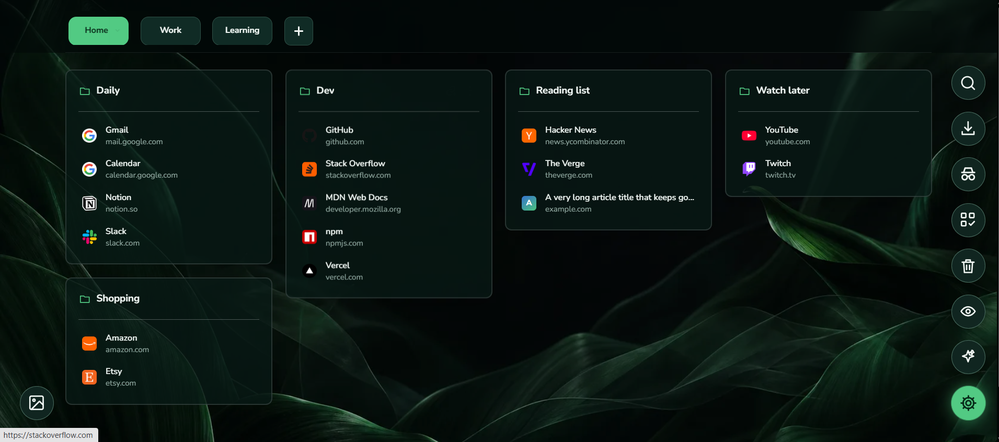

<div align="center">


# Tabora

**Your new tab, organized.** Turn every new tab into a calm, visual workspace of pages and boards for the links you actually use. Private by design: everything stays in your browser.

[](https://developer.chrome.com/docs/extensions/develop/migrate/what-is-mv3)
[](CHANGELOG.md)
[](LICENSE)
[](#privacy)

[Features](#features) · [Install](#install) · [Shortcuts](#keyboard-shortcuts) · [Privacy](#privacy) · [Development](#development) · [Changelog](CHANGELOG.md)

</div>

<p align="center">
  
</p>

## Why Tabora

- **Everything in its place.** Group links into boards, and boards into pages such as *Home*, *Work* and *Learning*.
- **Saving takes a second.** One shortcut saves the current tab; one click saves a whole window.
- **Nothing leaves your browser.** No account, no server, no tracking.

## Features

### Organize

- **Pages and boards.** Multiple pages, each with column-based boards you can color, label with an icon, resize and pin.
- **Drag to arrange.** Use Organize mode to move boards and links or delete several at once.
- **Smart Organize.** Regroups a page's links into categories such as Development, Videos and Reading, based on the website and whole words in the title. It can be undone.
- **No duplicates.** Tabora tells you where a link is already saved, whether you save it by hand or import it.

### Save

- **Quick Save** with <kbd>Ctrl</kbd>+<kbd>Shift</kbd>+<kbd>Y</kbd>, confirmed by a ✓ badge showing where the tab went.
- **Save a whole window** as a board from the toolbar popup.
- **Import** browser bookmarks (whole folders or individual links), open tabs, pasted lists, HTML, CSV and text files.
- **Automatic link details**: title, description and site icon are fetched when you save, once you allow optional site access.

### Find

- **Instant search** across titles, addresses, notes and board names, in a compact results panel. Press <kbd>/</kbd> to start.
- **Recent activity**: jump back to links you opened recently.
- **Link health check** finds links that are broken or have moved, and updates moved ones in one click.

### Make it yours

- **60 wallpapers**, dark and light, each with a matching interface palette. You can also upload your own.
- **Light and dark themes**, compact mode, shorter titles and optional descriptions.
- **Moods** save a page, theme and wallpaper together so you can switch contexts in one click.

### Stay safe

- **Undo** the last change with <kbd>Ctrl</kbd>+<kbd>Z</kbd>.
- **Trash** keeps deleted boards and links for 30 days.
- **Backup and restore**: export your whole workspace as a `.json` file and restore it later. The restore can be undone.
- **Private vaults** lock a page behind a password (AES-GCM, 600,000-round PBKDF2), together with its recent activity and trash.
- **Privacy blur** hides board contents when you share your screen. **Private opening** opens links in a private window and keeps them out of your history.

### Share

- **`.tabora` files** share a single board or page with anyone.
- **Shared Rooms** send a page as an encrypted code that expires after 24 hours. The password travels separately.
- **Copy** a link, a board or a whole page as plain text.

> **New in the next release:** each tab keeps its own page, saves can no longer overwrite each other, backups can be restored, and more. See the [changelog](CHANGELOG.md#unreleased).

## Install

### From a store

Chrome Web Store, Microsoft Edge Add-ons and Firefox Add-ons listings are coming soon.

### From source

1. Clone the repository:

   ```bash
   git clone https://github.com/mehmoodulhaq570/tabora.git
   ```

2. Load it in your browser:

   | Browser | Steps |
   |---|---|
   | Chrome, Edge, Brave, Opera, Vivaldi | Open the extensions page (for example `chrome://extensions`), turn on **Developer mode**, click **Load unpacked**, and select the `tabora` folder. |
   | Firefox | Open `about:debugging#/runtime/this-firefox`, click **Load Temporary Add-on**, and select `manifest.json`. |

3. Open a new tab. Tabora is your new-tab page.

## Getting started

1. **Create a board** with **Add board**, or let the welcome tour walk you through it.
2. **Fill it**: press <kbd>Ctrl</kbd>+<kbd>Shift</kbd>+<kbd>Y</kbd> on any page, use the toolbar popup, or import your existing bookmarks.
3. **Make it yours**: choose a wallpaper and theme from the appearance panel at the bottom left.

## Keyboard shortcuts

| Shortcut | Action |
|---|---|
| <kbd>Ctrl</kbd>+<kbd>Shift</kbd>+<kbd>Y</kbd> | Save the current tab to Quick Saves (works on any page) |
| <kbd>/</kbd> | Open search |
| <kbd>↑</kbd> <kbd>↓</kbd> | Move through search results and menus |
| <kbd>Ctrl</kbd>+<kbd>Z</kbd> | Undo the last change |
| <kbd>Esc</kbd> | Close search, menus and dialogs |

Change the Quick Save shortcut under **Settings → General → Change**, or in your browser's extension shortcut settings.

## Privacy

Tabora has no account, no server and no analytics.

- Your pages, boards, links and settings are stored only in this browser profile.
- Tabora contacts a website only when you save it (to fetch its title and icon) or run the link health check, and only after you grant optional site access. These requests send no cookies.
- Exports, backups and shared files stay on your device until you choose to share them.

### Permissions

| Permission | Why Tabora needs it |
|---|---|
| `tabs` | Read the title and address of tabs you save, open saved links, and optionally close tabs after saving a window. |
| `storage` | Keep your workspace, trash and undo history in local browser storage. |
| `unlimitedStorage` | Lift the 10 MB local storage limit so large collections keep saving. No data leaves the browser. |
| `clipboardWrite` | Copy links, boards, pages and room codes when you ask. |
| `favicon` | Show site icons from the browser's own icon cache (Chromium browsers), without contacting the site. |
| `search` | Hand a search to your default search engine when you choose "Search the web". |
| `bookmarks` *(optional)* | Import browser bookmarks, requested only when you choose to. |
| `http://*/*`, `https://*/*` *(optional)* | Fetch link details and check link health, requested only when first needed. |

## Your data

| Format | What it holds | How to use it |
|---|---|---|
| Backup (`.json`) | Your entire workspace: pages, boards, trash and preferences | **Settings → Export backup**; restore from **Import → Upload a file**. |
| `.tabora` file | One board or one page | Board or page menu → **Export**; anyone with Tabora can import it. |
| Room code | One page, encrypted, valid for 24 hours | **Workspace tools → Rooms**; send the code and the password separately. |

Each browser profile has its own separate workspace. Use a backup or `.tabora` files to move data between profiles or computers.

## Browser support

| Browser | Status |
|---|---|
| Chrome, Edge, Brave, Opera, Vivaldi (111+) | Supported. All use the same package. |
| Firefox (113+) | Supported through the same `manifest.json`. |
| Safari | Possible through Apple's converter; see [BROWSER_SUPPORT.md](BROWSER_SUPPORT.md). |

## Development

Tabora is plain JavaScript, HTML and CSS, with no build step and no dependencies.

### Project structure

```text
tabora/
├── manifest.json       Extension manifest (Manifest V3, Chromium and Firefox)
├── shared.js           State layer: storage, locking, migrations, import/export, wallpapers
├── background.js       Service worker: Quick Save shortcut, recording opened links
├── dashboard.html/js   The new-tab dashboard
├── features.js         Workspace tools: recent activity, link health, Smart Organize,
│                       moods, vaults, rooms
├── popup.html/js       The toolbar popup
├── styles.css          Styles for the dashboard and popup
├── assets/             Wallpapers, thumbnails and the bundled font
├── icons/              Extension icons
├── docs/images/        README images
└── tests/              Unit tests and a browser smoke test
```

### How it fits together

- **One state object** is stored under a single `storage.local` key and normalized on every read (`normalizeState`). Older data is upgraded automatically.
- **All writes are serialized.** `updateTaboraState` runs each read-change-write inside a Web Lock, so the dashboard, popup and background worker never overwrite each other. Don't call it from inside another update; Web Locks are not re-entrant.
- **Per-tab state stays in memory.** The current page and Organize mode belong to each tab; storage only remembers the last page used.
- **Undo** keeps one snapshot of the previous state; trash keeps items for 30 days.

### Running the tests

```bash
# Unit tests (Node.js 18+)
node tests/shared.test.js
node --test tests/background.test.js

# Browser smoke test (Node.js 22+): start a Chromium browser with a throwaway profile, then run it
"<path-to-browser>" --remote-debugging-port=9333 --user-data-dir=.browser-profile \
  --load-extension=. --disable-background-timer-throttling --disable-renderer-backgrounding \
  --disable-backgrounding-occluded-windows
node tests/browser-smoke.js
```

> The smoke test erases boards in the profile it connects to. Always use a throwaway `--user-data-dir`, never your everyday browser profile.

### State schema (v4)

```js
{
  schemaVersion: 4,
  pages: [],           // { id, name, order, protected }
  boards: [],          // { id, pageId, name, column, columnOrder, color, icon, size, pinned, links: [] }
  trash: [],           // { id, type: "board" | "link", value, deletedAt, ... }
  recentlyOpened: [],  // the latest 50 opened links
  moods: [],           // saved page, theme and wallpaper combinations
  vaults: [],          // encrypted pages: { id, salt, iv, cipher, iterations }
  settings: {}         // preferences and the last page used
}
```

## Roadmap

Ideas being explored for upcoming releases:

- A **command palette** (<kbd>Ctrl</kbd>+<kbd>K</kbd>) to search and run any action from the keyboard
- A **session timeline** with automatic snapshots of closed windows
- **Real site icons** served from the browser's own cache
- **Tags, saved filters** and List, Tiles or Queue views for each board
- A **theme studio** with accent colors picked automatically from the wallpaper
- **Restore points** and scheduled, encrypted backup files

## Contributing

Contributions are welcome. Please read [CONTRIBUTING.md](CONTRIBUTING.md) before opening an issue or pull request, and follow the [Code of Conduct](CODE_OF_CONDUCT.md).

## License

Tabora is released under the [MIT License](LICENSE).

<div align="center"><sub>Made for people with too many tabs.</sub></div>
